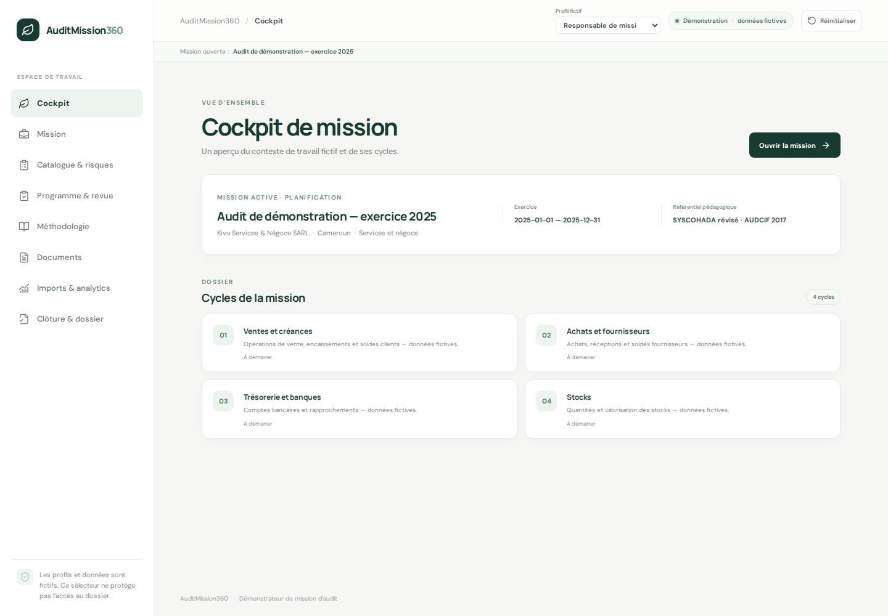
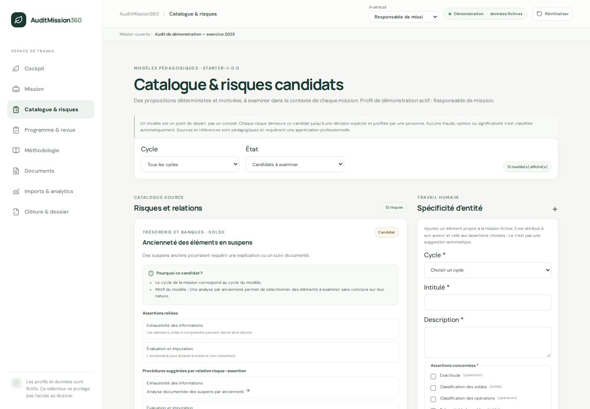
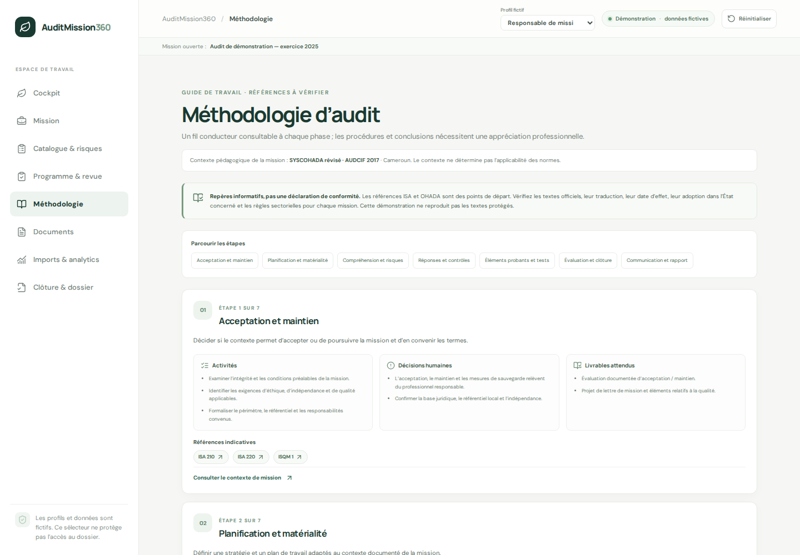
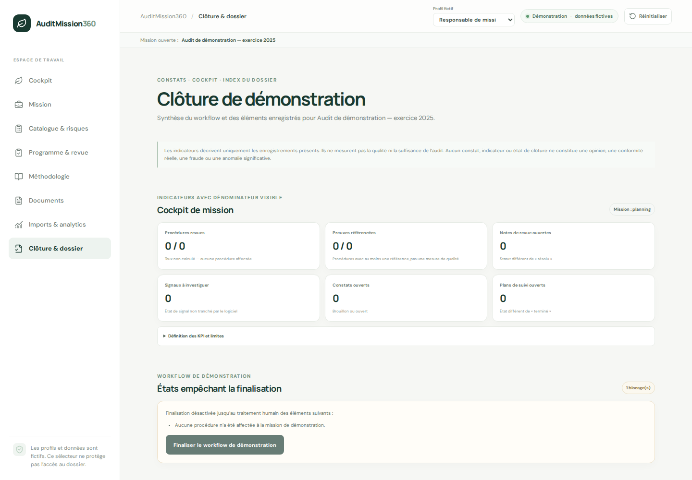

# AuditMission360

<p align="center">
  <strong>Un espace de démonstration pour structurer le parcours d’une mission d’audit financier.</strong><br />
  Du cadrage à la clôture, un dossier fictif, explicable et traçable — directement dans le navigateur.
</p>

<p align="center">
  
  
  
  
  
</p>

> **Prototype de portfolio — données entièrement fictives.** AuditMission360 ne remplace pas le jugement professionnel, ne certifie pas des comptes, ne conclut ni à une fraude ni à une anomalie significative et ne produit aucune opinion d’audit. N’y saisissez aucune information réelle, personnelle, comptable ou client.

## Aperçu

| Cockpit de mission | Catalogue et risques candidats |
|:---:|:---:|
|  |  |
| Méthodologie et références | Clôture et dossier de démonstration |
|  |  |

## Fonctionnalités

- **Mission et cockpit** — contexte pédagogique, exercice, référentiel choisi et cycles de travail.
- **Catalogue explicable** — modèles de risques, assertions et procédures proposés comme candidats, avec leurs motifs et références ; toute décision reste humaine, justifiée et enregistrée.
- **Programme et revue** — affectation de procédures, échantillons fictifs, résultats, références de preuves et échanges préparateur/réviseur.
- **Guide méthodologique** — sept étapes de travail et liens vers des sources IAASB et OHADA, avec statut et dates à vérifier.
- **Documents de travail** — modèles versionnés, brouillons modifiables, aperçu imprimable et export PDF par le navigateur.
- **Import et signaux analytiques** — chargement CSV, contrôles de cohérence et règles déterministes dont les résultats sont à investiguer par une personne.
- **Clôture et dossier** — indicateurs avec dénominateurs visibles, points en attente, constats, plans de suivi et index des sources.
- **Persistance locale** — données conservées dans IndexedDB sur l’appareil ; scénario fictif réinitialisable.

## Démarrage rapide

### Prérequis

- Node.js 20.19+ (ou 22.12+) et npm
- Python 3.12+ uniquement pour lancer l’API facultative

### Interface web

Depuis la racine du dépôt :

```bash
cd frontend
npm ci
npm run dev
```

Ouvrez l’adresse affichée par Vite (par défaut <http://localhost:5173>). L’interface fonctionne sans l’API : le dossier de démonstration est initialisé dans la base IndexedDB du navigateur.

### API facultative

Dans un autre terminal, depuis la racine du dépôt :

```bash
python3 -m venv .venv
.venv/bin/pip install -r backend/requirements.txt
.venv/bin/uvicorn app.main:app --app-dir backend --reload --host 127.0.0.1 --port 8001
```

L’API FastAPI est indépendante et sans état métier. Son endpoint <http://127.0.0.1:8001/health> renvoie `{"status":"ok"}`.

## Parcours de démonstration

1. Consultez le cockpit et le contexte de mission préchargé : entité pédagogique au Cameroun, exercice 2025 et SYSCOHADA comme choix de scénario.
2. Dans **Catalogue & risques**, examinez les motifs et références, puis confirmez, adaptez ou écartez les propositions avec une justification.
3. Dans **Programme & revue**, affectez un travail, consignez les résultats et références synthétiques, puis suivez les étapes de revue.
4. Explorez **Méthodologie** et **Documents** pour parcourir les repères de travail et les modèles imprimables.
5. Dans **Imports & analytics**, chargez le CSV fourni (`frontend/src/data/ledger-demo.csv`) ou un jeu fictif, puis examinez les signaux et leurs sources.
6. Terminez dans **Clôture & dossier** pour consulter les indicateurs, les éléments ouverts et l’index du dossier exportable.

Le bouton **Réinitialiser** demande confirmation et restaure les données locales du scénario fictif. Les aperçus et exports sont signalés comme des simulations ; aucun document n’est envoyé ou signé.

## Architecture

| Répertoire / fichier | Rôle |
|---|---|
| `frontend/` | React 19, TypeScript, Vite, React Router, Dexie/IndexedDB et tests Vitest/Testing Library. Les pages sont chargées à la demande. |
| `backend/` | API FastAPI stateless et son test de santé pytest. |
| `cahier-des-charges-auditmission360.md` | Périmètre fonctionnel, exigences et limites du prototype. |
| `dossier-auditmission360.html` | Dossier de conception. |
| `rapport-audit-financier-cemac.html` | Exemple de rapport fictif. |
| `implementation.md` et `tracking.md` | Plan d’implémentation et suivi des étapes. |
| `docs/screenshots/` | Captures d’écran de l’interface de démonstration. |

Les données métier restent dans le navigateur pour ce MVP. Les catalogues et analyses sont des règles de démonstration déterministes ; les profils sont des sélecteurs d’expérience locale, **pas** une authentification ni un contrôle d’accès. Il n’existe pas de synchronisation multi-utilisateur ni de garantie de conservation.

## Tests et build

Depuis `frontend/` :

```bash
npm test
npm run build
```

Depuis la racine pour l’API :

```bash
.venv/bin/pytest -c backend/pytest.ini backend/tests
```

## Déploiement du frontend

Le frontend peut être déployé comme application Vite statique. Pour une configuration Vercel au niveau du dépôt :

- **Root Directory** : `frontend`
- **Build Command** : `npm run build`
- **Output Directory** : `dist`
- **Install Command** : `npm ci`

Aucune variable d’environnement n’est requise pour le scénario local de démonstration. L’API FastAPI n’est pas nécessaire à l’interface et n’est pas configurée par ces paramètres statiques.

## Références et limites métier

La page **Méthodologie** donne accès aux publications IAASB et aux sources OHADA, avec des repères de version, publication, date d’effet et adoption locale à vérifier. Ces ressources ne constituent ni un avis juridique, ni une validation d’applicabilité, ni une déclaration de conformité ; aucun texte normatif protégé n’est reproduit. Les éditions révisées d’ISA 240 et ISA 570 mentionnées dans l’application sont annoncées comme applicables aux périodes ouvertes à compter du 15 décembre 2026, sous réserve de vérifier leur adoption.

Pour le périmètre métier complet et les précautions d’utilisation, consulter le [cahier des charges](cahier-des-charges-auditmission360.md).
